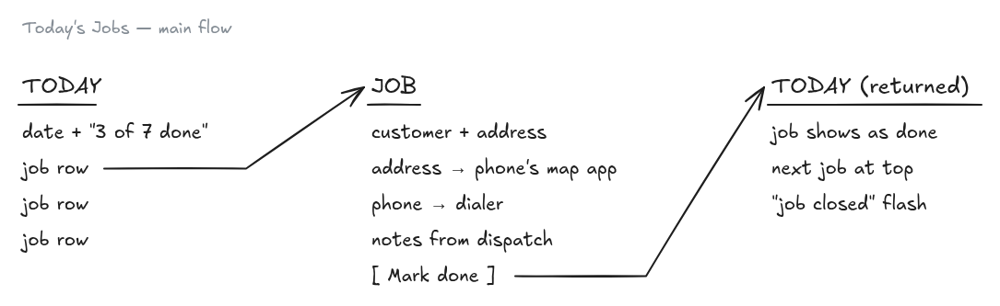
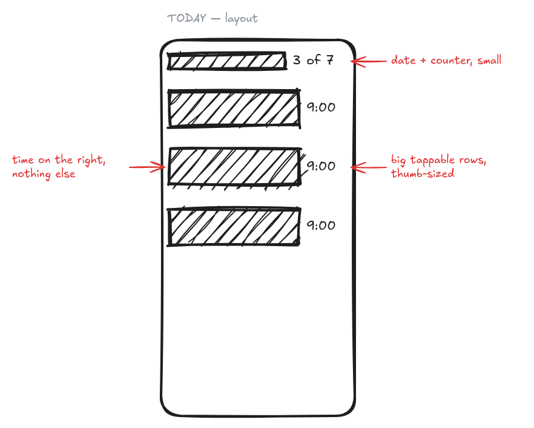
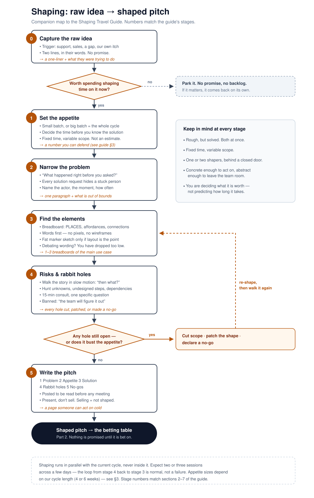

# Shape Up Shaping

**A Claude Code plugin that grills you through Shape Up shaping and writes the pitch.**

You describe a problem and the solution you have in mind, as messily as you like. Claude interviews you one question at a time, through the shaping stages from [Shape Up](https://basecamp.com/shapeup):

1. capture the raw idea;
2. set the appetite;
3. narrow the problem;
4. find the elements;
5. hunt the rabbit holes.

Then it plays back what it understood, including the assumptions you never stated, so you can correct it. Once you approve, it asks which language you want and writes a paste-ready `pitch.md`, with hand-drawn Excalidraw breadboards and fat marker sketches.





## What makes it different

- **It grills rather than fills in a template.** One question at a time, each with Claude's best guess attached, so most answers are "yes" or a one-line fix.
- **Appetite before solution.** If you open with a solution, it's parked until the appetite is set, then judged against it.
- **It checks your code.** Run inside a repository, and Claude answers technical rabbit-hole questions by reading the code instead of asking you.
- **It can say "not yet".** If something is still open, you get a not-ready note listing what's missing, instead of a pitch that hides it.
- **Rough on purpose.** The drawings come from a script with thick strokes and a coarse grid, so they can't turn into wireframes.

## Requirements

- [Claude Code](https://code.claude.com).
- For PNG drawings: Node 22+, the free Excalidraw CLI (`npm i -g @excalidraw/cli`), and Chrome, Edge, Chromium or Firefox installed. Without these you still get the pitch and editable `.excalidraw` files, which you can open free at [excalidraw.com](https://excalidraw.com).

## Install

**Option A — Claude Code plugin (recommended).** You get versioned updates. Run these in your terminal:

```
claude plugin marketplace add jotafarias13/shape-up-skills
claude plugin install shape-up@shape-up-skills
```

**Option B — `npx skills`.** This also works for other agents that support Agent Skills:

```
npx skills add jotafarias13/shape-up-skills -a claude-code
```

Add `-g` to install for all your projects instead of just the current one.

## Use

Start Claude Code inside the repository the idea is about, so it can check the code during the rabbit-hole stage. Then either:

- run the skill: `/shape-up:shaping` with the plugin, or `/shaping` with npx;
- or just say "let's shape…" and describe the problem.

Each shaping gets a folder, `shaping/YYYY-MM-DD-slug/`, containing:

- `pitch.md`
- `breadboard.png`, plus its `.excalidraw` source
- `ledger.md`, the working notes, so you can resume the shaping later

Paste `pitch.md` into ClickUp, Notion, Linear, Jira or a GitHub issue, and attach the PNGs. See [an example pitch](docs/example/pitch.md).

## Configure (optional)

Create `.shaping.json` in your project, and commit it so your team shares it. Or create `~/.shaping.json` for your personal defaults.

```json
{
  "cycleWeeks": 6,
  "languages": ["English", "Português (pt-BR)"],
  "outputDir": "shaping",
  "pitchDestination": "ClickUp",
  "shaper": "Your Name"
}
```

Every key is optional. See [skills/shaping/references/config.md](skills/shaping/references/config.md) for details.

## Update

- **Plugin:** `claude plugin update shape-up@shape-up-skills`, or turn on auto-update for the marketplace in `/plugin`.
- **npx:** `npx skills check` shows whether an update exists, and `npx skills update` installs it.

See [CHANGELOG.md](CHANGELOG.md) for what changed.

## What's inside

```
skills/shaping/          the grill: flow, per-stage grill map, pitch template, shaping guide
skills/shapeup-sketch/   the drawings: spec → .excalidraw → PNG, with examples
docs/                    the shaping flowchart, an example pitch, the maintainer guide
```



## Credits

The method is from [Shape Up](https://basecamp.com/shapeup) by Ryan Singer (Basecamp), free to read online. The shaping guide bundled here is an original companion to Part 1 of the book. Drawings render with [Excalidraw](https://excalidraw.com). This project is not affiliated with Basecamp, Excalidraw or Anthropic.

## License

[MIT](LICENSE)
